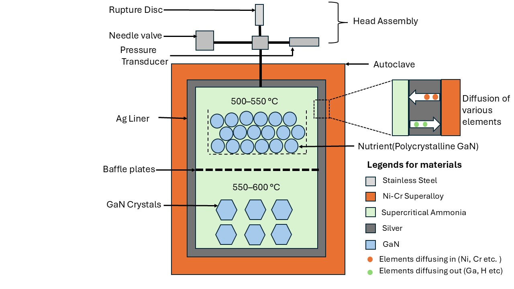
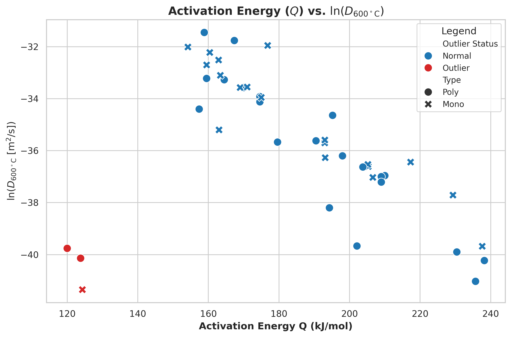
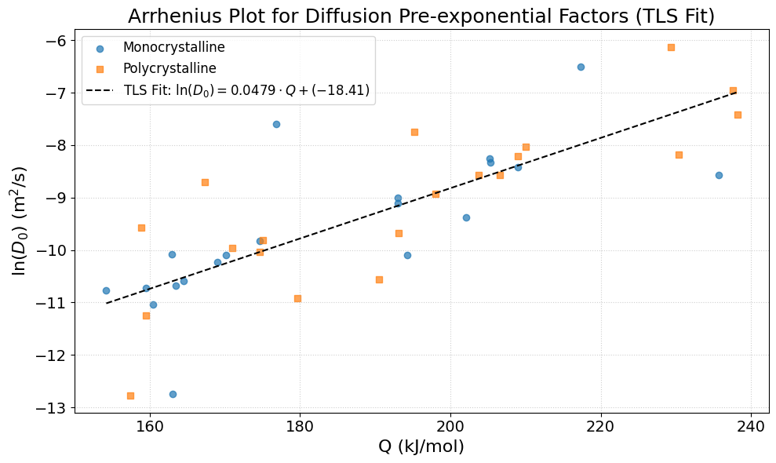
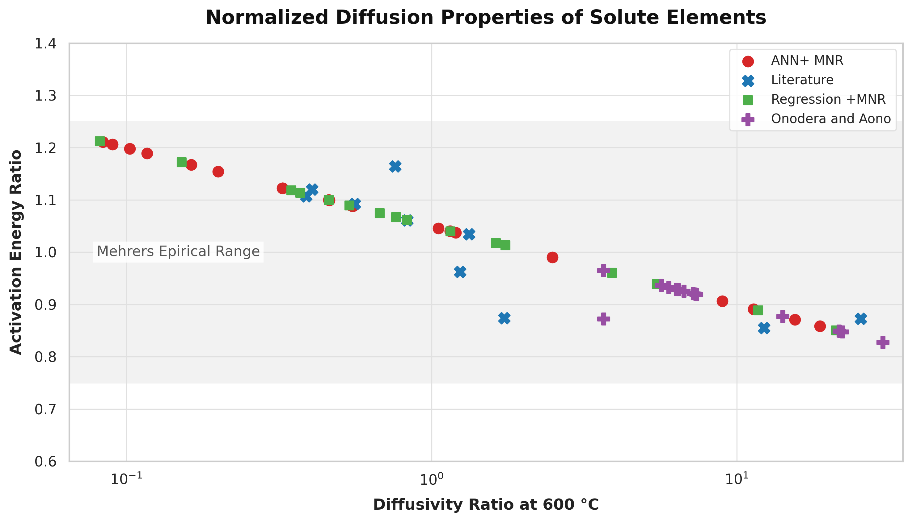
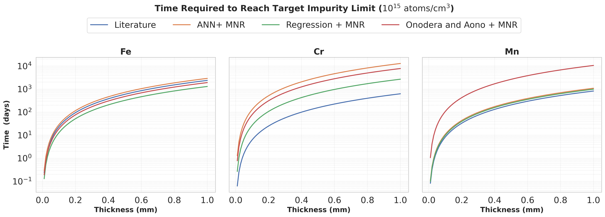
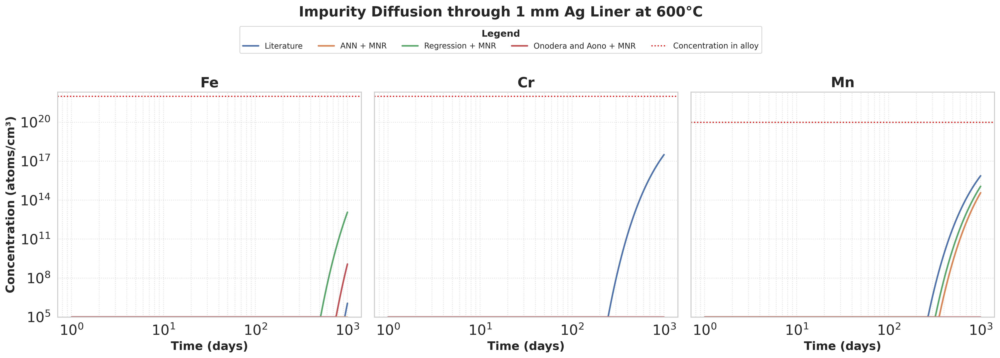

# Diffusion in Autoclave Noble-Metal Liners

[](https://www.python.org/)
[](https://panel.holoviz.org/)
[](https://bokeh.org/)
[](https://mybinder.org/v2/gh/anikaitchatterjee10/Diffusion-in-autoclave-noble-metal-liners-/main?urlpath=lab)
[](data/Mehrer_Window.xlsx)

Semi-empirical framework for **predicting transition-metal diffusion through
silver barriers** under ammonothermal crystal-growth conditions
(> 300 °C, 100–400 MPa).

This repository accompanies the manuscript:

> **A. Chatterjee, V. Y. M. R. Chirala, T. Wostatek, S. Arnold, S. Schimmel**,
> *"Predicting Transition Metal Diffusion through Silver Barriers at High
> Temperatures Relevant to Ammonothermal Crystal Growth"*, **Materials** (2026).

The framework combines:

1. A **Meyer–Neldel correlation** `log D₀ = −18.41 + Q / 20.87 kJ mol⁻¹`
   fitted by Total Least Squares to 40 literature Arrhenius pairs.
2. Three independent **activation-energy estimators** (ANN, regression,
   Onodera & Aono MRA) to bound the uncertainty for data-deficient solutes.
3. Analytical solutions of **Fick's second law** to convert those parameters
   into barrier-performance predictions.

---

## 📊 Results at a glance

### 1. Ammonothermal autoclave with Ag liner — Fig. 1
Schematic of the high-pressure autoclave, showing the Ag liner separating the
supercritical ammonia from the corroding René 41 / Inconel wall, together with
the relevant solute species diffusing in (Fe, Cr, Mn, Ni, …) and out (Ga, N).

<p align="center">
  
  <br>
  <sub><b>Figure 1.</b> Schematic of the ammonothermal GaN growth autoclave
  with an Ag liner.</sub>
</p>

### 2. Diffusion coefficient vs. activation energy — Fig. 2
Compiled impurity–Ag datasets at 600 °C. Three literature entries flagged as
statistical outliers by the Z-score screen are highlighted in red and excluded
from the primary Meyer–Neldel regression.

<p align="center">
  
  <br>
  <sub><b>Figure 2.</b> Diffusion coefficient at 600 °C plotted as ln D versus
  activation energy Q for the compiled impurity–Ag datasets. The three datasets
  flagged as statistical outliers by the Z-score screen are shown in red.</sub>
</p>

### 3. Meyer–Neldel plot — Fig. 3
Correlation between the pre-exponential factor `D₀` and the activation energy
`Q` for the 40 retained bulk-diffusion datasets. The black dashed line is the
Total-Least-Squares fit

```
log D₀ = −18.41 + Q / 20.87 kJ mol⁻¹        (standard error 0.936)
```

<p align="center">
  
  <br>
  <sub><b>Figure 3.</b> Meyer–Neldel plot: correlation between the
  pre-exponential factor D₀ and activation energy Q of various elements
  diffusing in Ag. The black dashed line is the total-least-squares fit.</sub>
</p>

### 4. Consistency check against Mehrer's empirical window — Fig. 4
Normalized diffusivity ratio vs. activation-energy ratio at 600 °C for all
estimated `(D₀, Q)` pairs, overlaid on Mehrer's empirical range for ordinary
substitutional solutes in close-packed metals. Nearly all predictions fall
inside the shaded band, confirming that the parameter sets are physically
reasonable.

<p align="center">
  
  <br>
  <sub><b>Figure 4.</b> Comparison of calculated normalized diffusion
  parameters for solutes in Ag with Mehrer's empirical ranges for ordinary
  substitutional solutes in close-packed metals.</sub>
</p>

### 5a. Barrier performance — time to reach the SIMS limit
Time required for Fe, Cr, and Mn to reach the SIMS detection limit
(10¹⁵ cm⁻³) at the inner Ag surface, as a function of barrier thickness at
600 °C. Bands come from propagating all three `(D₀, Q)` estimation methods
(ANN + MNR, Regression + MNR, Onodera & Aono + MNR) together with the
literature values.

<p align="center">
  
  <br>
  <sub><b>Figure 5a.</b> Time required for Fe, Cr, and Mn to reach the
  minimum SIMS-detectable concentration of 10¹⁵ cm⁻³ at the inner surface of
  the Ag barrier, as a function of barrier thickness.</sub>
</p>

### 5b. Inner-surface concentration vs. exposure time
Time-dependent impurity concentration at the inner surface of a **1 mm Ag
liner**, using **René 41** as a representative autoclave alloy (600 °C). The
red dotted line is the SIMS detection limit; all curves stay several orders
of magnitude below it for service lifetimes of a few years.

<p align="center">
  
  <br>
  <sub><b>Figure 5b.</b> Time-dependent impurity concentration at the inner
  surface of a 1 mm Ag liner, calculated using René 41 as a representative
  autoclave alloy.</sub>
</p>

### 🎥 Interactive dashboard
The Panel/Bokeh dashboard reproduces Fig. 5a and Fig. 5b for any element,
alloy, temperature, thickness, and exposure time.

<p align="center">
  
</p>

---

## 🚀 Install

```bash
git clone https://github.com/anikaitchatterjee10/Diffusion-in-autoclave-noble-metal-liners-.git
cd Diffusion-in-autoclave-noble-metal-liners-
pip install -r requirements.txt
```

## ▶️ Run the interactive dashboard

```bash
agdiffusion-serve          # opens on http://localhost:5006
```

Or from a notebook:

```python
from agdiffusion.dashboard import app
app.servable()
```

## 🧪 Quickstart (Python API)

```python
from agdiffusion import (load_diffusion_data, arrhenius_D,
                         time_to_reach, source_concentration, DAY)

data  = load_diffusion_data("data/Mehrer_Window.xlsx")
C0_Fe = source_concentration("Fe", "Rene41")

for method, (D0, Q) in data["Fe"].items():
    D = arrhenius_D(D0, Q, T_K=873.15)         # 600 °C
    t = time_to_reach(C0_Fe, L_m=1e-3, D=D) / DAY
    print(f"Fe / {method:<15s} -> {t:,.0f} days for 1 mm Ag")
```

## 📁 Repository structure

```
Diffusion-in-autoclave-noble-metal-liners/
├── agdiffusion/          Core package (data, physics, plots, dashboard)
├── data/                 Excel source of Arrhenius parameters
├── docs/images/          Figures shown in this README
├── notebooks/            Demo notebook
├── examples/             Minimal scripts
├── README.md
├── requirements.txt
├── pyproject.toml
└── LICENSE
```

## 📖 Data source

All Arrhenius parameters live in **`data/Mehrer_Window.xlsx`**. Each row is
one solute; columns are:

| Method | D₀ column | Q column |
|---|---|---|
| Literature | B | D |
| ANN + MNR | H | J |
| Regression + MNR | N | O |
| Onodera & Aono | S | T |

Units: `D₀` in m² s⁻¹, `Q` in kJ mol⁻¹.

## 📜 Citation

If you use this code, please cite:

```bibtex
@article{Chatterjee2026AgDiffusion,
  title   = {Predicting Transition Metal Diffusion through Silver Barriers
             at High Temperatures Relevant to Ammonothermal Crystal Growth},
  author  = {Chatterjee, Anikait and Chirala, V. Y. M. Rajesh and
             Wostatek, Thomas and Arnold, Simon and Schimmel, Saskia},
  journal = {Materials},
  year    = {2026}
}
```


