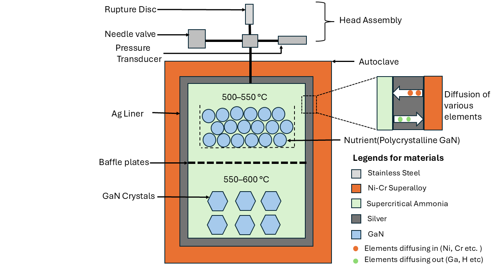
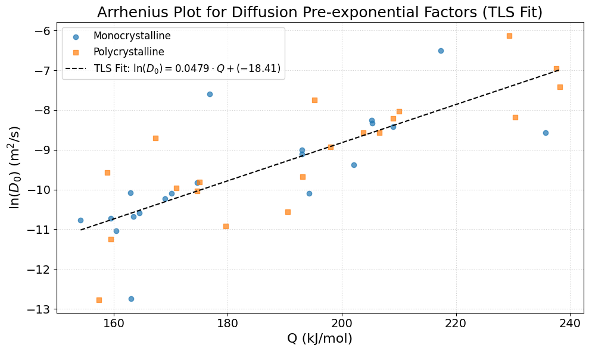
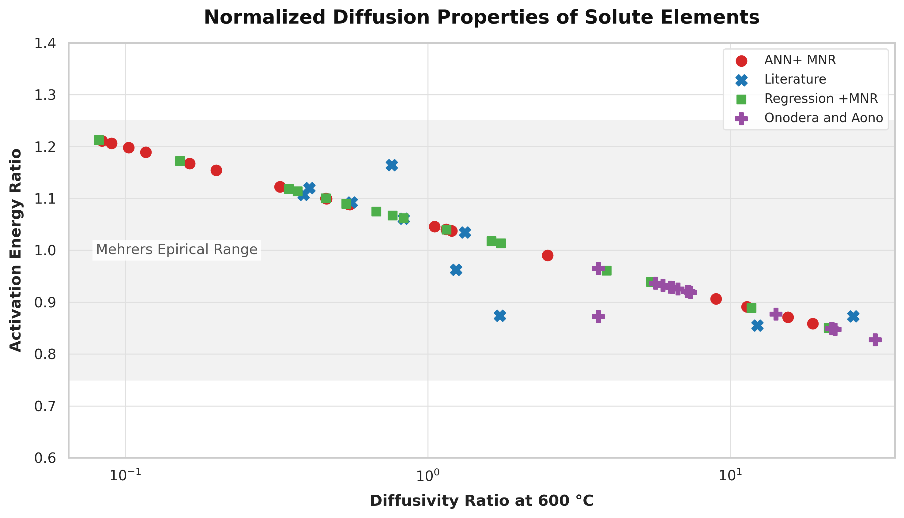
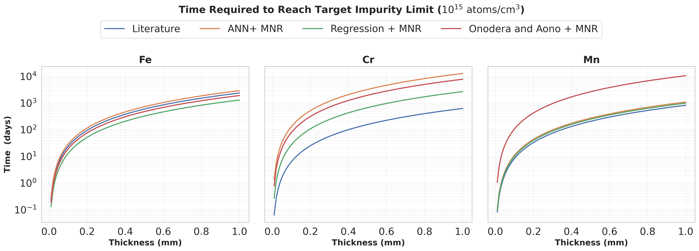
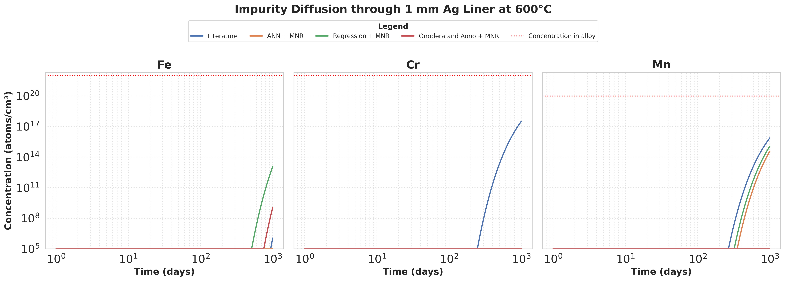

# PyLiner — Diffusion in Autoclave Noble-Metal Liners
[](https://www.python.org/)
[](https://panel.holoviz.org/)
[](https://bokeh.org/)
[](https://mybinder.org/v2/gh/anikaitchatterjee10/Diffusion-in-autoclave-noble-metal-liners-/main?urlpath=lab)
[](data/Diffusion%20Coefficients.xlsx)

Semi-empirical framework for **predicting transition-metal diffusion through silver barriers** under ammonothermal crystal-growth conditions (> 300 °C, 100–400 MPa).

This repository accompanies the manuscript:

> (Cite)[cite: 1]

---

## 🔬 Methodology Overview

### 1. Data Sources & Parameter Compilation
The calculation workflow compiles pre-exponential factors ($D_0$, in $\text{m}^2\,\text{s}^{-1}$) and activation energies ($Q$, in $\text{kJ}\,\text{mol}^{-1}$) across multiple sources:
* **Experimental Literature Data**: Raw solute diffusion parameters ($D_0$ and $Q$) compiled from published studies for solutes diffusing in silver.
* **Semi-Empirical Feature Model**: Parameters supporting activation energy ($Q$) estimation following Onodera et al.[cite: 2]
* **Compiled Predictive Models**: Compiled machine-learning / predictive activation energy ($Q$) estimates (including Zeng et al.)[cite: 2].

### 2. Arrhenius Diffusivity & Log-Diffusivity Evaluation at 600 °C
For each compiled solute entry with numeric $D_0$ and $Q$ values, the bulk diffusion coefficient at $600\text{ }^\circ\text{C}$ ($873.15\text{ K}$) is evaluated using the Arrhenius relation with the universal gas constant $R = 8.314462618\text{ J}\,\text{mol}^{-1}\,\text{K}^{-1}$ (converting $Q$ from $\text{kJ}\,\text{mol}^{-1}$ to $\text{J}\,\text{mol}^{-1}$), alongside its natural logarithm $\ln(D_{600\,^\circ\text{C}})$[cite: 2]. Solutes can then be ranked in descending order of diffusivity at $600\text{ }^\circ\text{C}$[cite: 2].

### 3. Joint 2D Z-Score Outlier Screening
To evaluate statistical consistency across solute entries at $600\text{ }^\circ\text{C}$, standardized Z-scores are computed independently for activation energy $Q$ and $\ln(D_{600\,^\circ\text{C}})$ relative to the dataset mean and sample standard deviation[cite: 2]:
* **Standardized Scores**: Each entry receives a Z-score for $Q$ ($Z_Q$) and a Z-score for $\ln(D_{600\,^\circ\text{C}})$ ($Z_{\ln(D_{600\,^\circ\text{C}})}$)[cite: 2].
* **Joint 2D Euclidean Distance**: A combined 2D Z-score metric is computed as the Euclidean norm $\sqrt{Z_Q^2 + Z_{\ln(D_{600\,^\circ\text{C}})}^2}$[cite: 2].
* **Classification Thresholds**:
  * **Confirmed Outlier**: Joint 2D Z-score distance $> 3.0$[cite: 2]
  * **Marginal Outlier**: Joint 2D Z-score distance $> 2.0$ (and $\le 3.0$)[cite: 2]
  * **Typical**: Joint 2D Z-score distance $\le 2.0$[cite: 2]

### 4. Meyer–Neldel Compensation, Estimator Bounding & Barrier Modeling
* **Meyer–Neldel Correlation**: Total-Least-Squares regression across retained bulk-diffusion datasets yields $\log D_0 = -18.41 + Q / 20.87\text{ kJ}\,\text{mol}^{-1}$ (standard error $0.936$)[cite: 1].
* **Estimator Bounding**: Multiple activation-energy estimation approaches bound uncertainty for solutes with limited or missing experimental data[cite: 1, 2].
* **Barrier Performance**: Diffusivities are linked to barrier thickness, exposure time, and impurity concentration limits (such as the SIMS detection limit of $10^{15}\text{ cm}^{-3}$) for autoclave liner evaluation[cite: 1].

---

## 📊 Plots & Results at a Glance

### 1. Ammonothermal Autoclave with Ag Liner — Fig. 1
Schematic of the high-pressure autoclave showing the Ag liner separating supercritical ammonia from the autoclave wall (such as René 41 / Inconel), along with inward-diffusing solute species (Fe, Cr, Mn, Ni, …) and outward species (Ga, N)[cite: 1].

<p align="center">
  
  <br>
  <sub><b>Figure 1.</b> Schematic of the ammonothermal GaN growth autoclave with an Ag liner[cite: 1].</sub>
</p>

### 2. Activation Energy ($Q$) vs. $\ln(D)$ with Outlier Highlighting — Fig. 2
Scatter plot of $\ln(D)$ at $600\text{ }^\circ\text{C}$ versus activation energy $Q$ ($\text{kJ}\,\text{mol}^{-1}$) for the compiled Ag solute dataset, distinguishing lower-$Q$ outlier entries ($Q < 145\text{ kJ}\,\text{mol}^{-1}$, such as `Fe1`, `Co2`, `Ni1`) in red from normal entries in blue[cite: 1, 2].

<p align="center">
  
  <br>
  <sub><b>Figure 2.</b> Activation energy (Q) vs. ln(D) at 600 °C for the compiled solute–Ag dataset with low-Q outliers highlighted[cite: 1, 2].</sub>
</p>

### 3. Meyer–Neldel Plot — Fig. 3
Correlation between pre-exponential factor $D_0$ and activation energy $Q$ for retained bulk-diffusion datasets, with the dashed trendline representing the Total-Least-Squares fit ($\log D_0 = -18.41 + Q / 20.87\text{ kJ}\,\text{mol}^{-1}$, standard error $0.936$)[cite: 1].

<p align="center">
  
  <br>
  <sub><b>Figure 3.</b> Meyer–Neldel plot of pre-exponential factor D₀ versus activation energy Q for solutes in Ag[cite: 1].</sub>
</p>

### 4. Consistency Check Against Mehrer's Empirical Window — Fig. 4
Comparison of normalized diffusion parameters for solutes in Ag against Mehrer's empirical range for substitutional solutes in close-packed metals at $600\text{ }^\circ\text{C}$[cite: 1].

<p align="center">
  
  <br>
  <sub><b>Figure 4.</b> Comparison of calculated normalized diffusion parameters for solutes in Ag with Mehrer's empirical ranges[cite: 1].</sub>
</p>

### 5a. Barrier Performance — Time to Reach the SIMS Limit
Time required for key transition-metal impurities (such as Fe, Cr, and Mn) to reach the SIMS detection limit ($10^{15}\text{ cm}^{-3}$) at the inner Ag liner surface as a function of barrier thickness at $600\text{ }^\circ\text{C}$, showing uncertainty bands across estimation methods and literature data[cite: 1].

<p align="center">
  
  <br>
  <sub><b>Figure 5a.</b> Time to reach the 10¹⁵ cm⁻³ SIMS limit at the inner Ag barrier surface versus barrier thickness[cite: 1].</sub>
</p>

### 5b. Inner-Surface Concentration vs. Exposure Time
Time-dependent impurity concentration at the inner surface of a **1 mm Ag liner** at $600\text{ }^\circ\text{C}$ (using **René 41** as a representative autoclave alloy) relative to the SIMS detection limit[cite: 1].

<p align="center">
  
  <br>
  <sub><b>Figure 5b.</b> Time-dependent inner-surface impurity concentration for a 1 mm Ag liner with René 41[cite: 1].</sub>
</p>

### 🎥 Interactive Dashboard
Interactive Panel/Bokeh interface for exploring barrier performance and inner-surface concentration across solutes, alloys, temperatures, liner thicknesses, and exposure times[cite: 1].

<p align="center">
  
</p>

---

## 📁 Repository Structure

```text
Diffusion-in-autoclave-noble-metal-liners/
├── agdiffusion/          Core package (data, physics, plots, dashboard)
├── data/                 Spreadsheets of diffusion and estimator parameters
├── docs/images/          Figures displayed in this README
├── notebooks/            Calculation and exploration notebooks
├── examples/             Minimal usage scripts
├── README.md
├── requirements.txt
├── pyproject.toml
└── LICENSE
```[cite: 1, 2]

---

## 📖 Data Overview

The calculation pipeline uses structured tabular inputs containing solute identifiers, literature references, pre-exponential factors $D_0$ ($\text{m}^2\,\text{s}^{-1}$), activation energies $Q$ ($\text{kJ}\,\text{mol}^{-1}$), and semi-empirical / predictive model columns[cite: 1, 2].

---

## 📜 Citation

If you use this repository or methodology, please cite:

> (Cite)[cite: 1]
